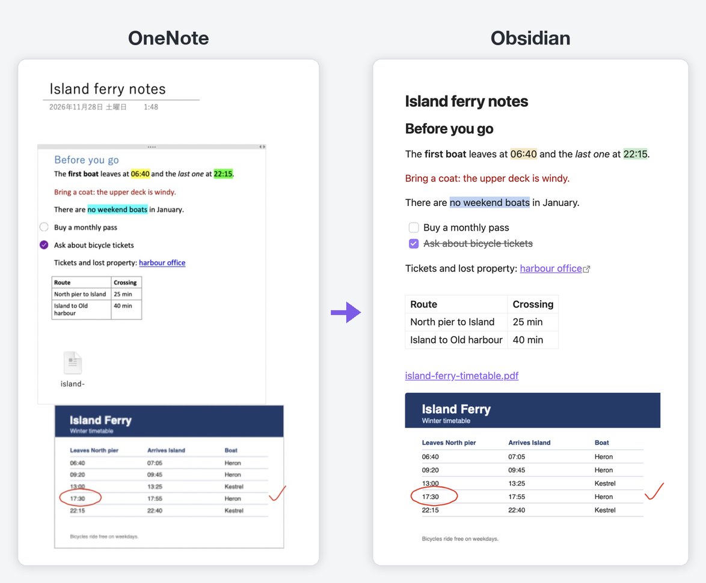

# OneNote Ferry

English | [中文](#中文) | [日本語](#日本語) | [한국어](#한국어)

Convert your OneNote notebooks into Markdown notes in Obsidian with highlights, links, handwriting and original attachments intact, and keep them up to date as you go on using OneNote.

[](https://ko-fi.com/alcatrazyu)

☕ OneNote Ferry is free and will stay free. If it saves you time moving your notes, you can [buy me a coffee](https://ko-fi.com/alcatrazyu).

OneNote Ferry reads the files your notebooks are stored in, straight from your OneDrive or from a download, and writes every page as a Markdown note in your vault. It runs inside Obsidian on your computer and does not need OneNote for Windows, so it works on a Mac as well.



## Why OneNote Ferry

There are already several ways to move notes out of OneNote. OneNote Ferry is meant for the cases they leave open:

- **Your notes are on a Mac, or there are many of them.** OneNote for Mac exports only PDF, and most converters need OneNote for Windows. Converting through Microsoft's online interface, as Obsidian's official [Importer](https://github.com/obsidianmd/obsidian-importer) does, is held to Microsoft's request limits, which makes large notebooks slow. OneNote Ferry reads the notebook files themselves, so it needs neither. As far as we know, no other Obsidian plugin reads the notebook files downloaded from OneDrive.
- **Your notes depend on their details.** Highlight colors, links between pages, the original attachments, printouts and their text, and handwriting where it was written are all kept. Anything that cannot be converted is listed in a report, so nothing goes missing without notice.
- **You keep writing in OneNote.** A check for updates brings in only what changed, keeps every version it replaces, and leaves your edits in Obsidian alone.

Which tool suits which situation:

| Your situation | Suggested tool |
| --- | --- |
| A few notebooks, mostly text, and you want the simplest setup | [Obsidian Importer](https://github.com/obsidianmd/obsidian-importer) (official) |
| You are also moving notes from Evernote, Notion or other apps | [Obsidian Importer](https://github.com/obsidianmd/obsidian-importer) (official) |
| You have OneNote for Windows and want a one-time export | [OneNote Md Exporter](https://github.com/alxnbl/onenote-md-exporter) or OneNote Ferry |
| You use a Mac, or have many notebooks with highlights, screenshots and text boxes | OneNote Ferry |
| You keep using OneNote and want Obsidian to follow | OneNote Ferry |

## Quick Start

1. Install and enable OneNote Ferry from Obsidian's Community plugins. It works in Obsidian on the desktop.
2. Click the paper boat icon  in the left ribbon, or run `Import OneNote notes` from the command palette.
3. Choose where your notebooks come from: `Import from OneDrive`, or `Choose files or folders` for a download from the OneDrive website or a OneNote for Windows export.
4. Tick the notebooks and sections you want, and click `Start import`.
5. When the import finishes, click `Open report` to see what was converted.

## What Gets Converted

- **Text**: formatting, font colors, highlights in their own colors, headings, lists with their numbering, tables, tags (as callouts or task boxes), equations (as LaTeX) and web links.
- **Links between pages**: rewritten as links inside your vault.
- **Pictures and attachments**: kept as the original files. TIF pictures become PNG with the same pixels. Formats Obsidian cannot show, such as EMF, are linked with a note saying so.
- **Printouts**: a printout of a PDF shows the original PDF. A printout made in OneNote for Windows whose original is not in the notebook (a Word document, for example) is drawn page by page from the printout itself.
- **Text in printouts and pictures**: the text of each printout page is kept below it in a folded box, so it can be searched in Obsidian. With `Text in pictures` turned on, the alt text of pictures and the text OneNote recognized in them are kept the same way.
- **Handwriting and highlighter**: drawn as a picture where they were written. Highlighter strokes are drawn onto the picture or handwriting they mark.
- **Structure**: a folder for each notebook and section, pages in OneNote's order and hierarchy, sections in the order OneNote shows them, and a contents page for each notebook and section.
- **Text boxes**: in reading order, with an optional hidden comment giving each one's position on the page.
- **A report** of what was converted, and of anything that could not be.

## Where Your Notebooks Come From

| Source | What you need | When to use it |
| --- | --- | --- |
| OneDrive | A Microsoft account and an internet connection | The usual way. Later updates download only what changed. |
| A download from the OneDrive website | The zip file, or the folder after unzipping it | When you would rather not sign in from Obsidian, or want to work offline. |
| A OneNote for Windows export | A notebook (`.onepkg`) or a section (`.one`) exported by OneNote for Windows | For notebooks kept on a Windows PC, or a single section. |

## Importing

### From OneDrive

1. Open the import window (step 2 of Quick Start) and choose `Import from OneDrive`.
2. Sign in to your Microsoft account in the browser that opens. When the page says you are signed in, return to Obsidian.
3. Your notebooks are listed with their sections. Nothing is downloaded or ticked yet. Tick what you want. A notebook missing from the list can be added with `Look in another folder`.
4. Click `Start import`. Only the sections you ticked are downloaded. You can close the window: the import continues, with its progress in the status bar.

The page in the browser is shown only once. If the browser later says it cannot reach `localhost`, check in Obsidian whether you are signed in, and if not, start the sign-in again from there.

### From a download

1. On the OneDrive website, download the folder that holds your notebooks (usually `Documents`). You get a zip file.
2. In the import window, choose `Choose files or folders` and pick the zip file, or the folder after unzipping it.
3. Tick what you want and click `Start import`.

### From a OneNote for Windows export

1. In OneNote for Windows, use `File` > `Export` to export a notebook as a OneNote Package (`.onepkg`) or a section as a OneNote Section (`.one`).
2. In the import window, choose `Choose files or folders` and pick the exported file.
3. Tick what you want and click `Start import`.

On Windows and Linux, the window shows `Choose files` and `Choose folders` instead of `Choose files or folders`. When the folder you import into already holds some of these notebooks, the sections you tick are added to them.

If you close the import window before starting, what you chose is kept until you quit Obsidian, and anything still being read or checked carries on, with its progress in the status bar. When you open the window again, it first checks whether your sources or your vault changed meanwhile. To start afresh, remove the sources with their ×.

## Keeping Notes Up to Date

If you keep using OneNote, open the import window the same way you did to import, and choose the same source: `Import from OneDrive`, or a newer download or export of your notebooks. The window compares each notebook you imported before with your vault and ticks the sections that changed or are new. Click `Start update`. (The command `Check for OneNote updates` opens the same window, ready to check OneDrive.)

`Import into` must be the folder you imported into before: the window compares only with the notebooks in that folder, and with another folder they would be imported there anew. The window remembers the folder you last imported into; if you keep notebooks in more than one folder, choose the one that holds the notebooks to update.

- Only the pages OneNote changed are replaced. The copy in your vault goes to `_previous versions` first.
- Pages you edited in Obsidian stay as they are, unless OneNote changed them too. Then OneNote's version goes in, yours is kept in `_previous versions`, and the window points it out.
- Pages you deleted in Obsidian stay deleted. To bring one back, open its section and tick the page.
- Nothing is deleted from your vault. Pages and sections removed in OneNote stay, and their contents page lists them.
- To convert sections again with other settings, change the settings in the window, then click a section marked `No changes`. It then shows `Convert again`.
- Each update writes what it changed to `_sync log`.

Notebooks from OneDrive are recognized by their OneDrive ID, so a notebook renamed in OneNote, or a folder you renamed in Obsidian, is still found. Notebooks from downloads are recognized by name.

## Settings

The import window shows these settings for each import. The plugin's settings hold their defaults.

- **Import into** (**Folder** in the plugin's settings): where imported notes go. Each notebook and section gets its own subfolder. The window remembers the folder you last imported into.
- **Language of contents pages and notices**: English, Simplified Chinese, Traditional Chinese, Japanese or Korean. A notebook keeps the language it was first imported with.
- **Text box positions**: on pages laid out in columns, a hidden comment before each text box says where it sat on the page.
- **Text in pictures**: keeps the alt text of pictures and the text OneNote recognized in them, folded below each picture. Printout pages always get their text.

## What You Will Find in Your Vault

```
OneNote/                        the folder you import into
├── _conversion report.md       what was imported, and what could not be
├── _previous versions/         pages that updates replaced
├── _sync log/                  what each update changed
└── My notebook/
    ├── _contents.md            the notebook's sections
    ├── Lectures/               a section
    │   ├── _contents.md        its pages, in OneNote's order
    │   ├── First lecture.md
    │   └── _attachments/       its pictures and files
    └── Archive/                a section group, holding its sections
```

These names follow the language setting, for example `_目录.md` in Chinese.

## Privacy and Safety

- **Your OneNote files are only read.** In OneDrive, the plugin has read permission only and cannot change or delete anything.
- **Everything happens on your computer.** There is no server of ours and no telemetry, and nothing is uploaded.
- **The plugin writes only inside the folder you import into**, and in its download cache (below). It never deletes anything in your vault.

**Microsoft account.** It is needed only to import from OneDrive. A download or an export needs no account.

- You sign in on Microsoft's own page in your browser, so the plugin never sees your password. Microsoft sends the result to a one-time address on your own computer (`127.0.0.1`), and the page you then see comes from the plugin.
- Permissions asked for: `Files.Read` to read your files, `offline_access` to stay signed in, and `openid` and `profile` to tell a personal account from a work or school one.
- The plugin connects only to Microsoft: its sign-in service, Microsoft Graph (`graph.microsoft.com`) to list notebooks and files, and Microsoft's file servers to download them.
- The sign-in is kept in Obsidian's secret storage, not in the plugin's settings file. `Sign out` in the plugin's settings forgets it on this device.
- To withdraw the plugin's access, go to [account.live.com/consent/Manage](https://account.live.com/consent/Manage) for a personal account, or [myapps.microsoft.com](https://myapps.microsoft.com) for a work or school account.

**Download cache.** Notebooks downloaded from OneDrive are kept outside your vault, so that later only changes are downloaded: in `~/Library/Caches/onenote-ferry/onedrive` on macOS, `%LOCALAPPDATA%\onenote-ferry\onedrive` on Windows, and `~/.cache/onenote-ferry/onedrive` on Linux. `Download cache` in the plugin's settings shows its size and can clear it; your notes in the vault stay. Clear it before you uninstall the plugin.

OneNote Ferry is an independent project, not made or endorsed by Microsoft. OneNote and OneDrive are trademarks of Microsoft.

## Known Limits

These are the main things OneNote Ferry does differently from OneNote, or does not handle yet:

- The free layout of a page (exact positions, fonts and sizes) is not reproduced. Text boxes follow reading order.
- OneNote does not record where a picture sits inside a text box, so handwriting and highlighter on such a picture are placed by estimate. When the estimate is uncertain, the picture is kept as it is, with a folded copy that shows the estimate.
- Password-protected sections cannot be read. Remove the password in OneNote, then import again.
- Only notebooks in your own OneDrive are listed, not those shared with you. A work or school account may need its administrator's approval before you can sign in.
- OneNote Ferry is developed and tested on macOS. Windows and Linux are not verified yet.

Less common cases are listed in [docs/requirements.md](docs/requirements.md) (in Chinese).

## Feedback

Everyone's OneNote notebooks are different, and OneNote Ferry keeps improving as it meets new ones. If a page does not convert as you expect, or something is missing, please [open an issue](https://github.com/AlcatrazYU/onenote-ferry/issues). The conversion report, a description of the page, or a small notebook made for the purpose helps most; please do not attach private notes. Suggestions are welcome too.

## Languages

The interface follows Obsidian's language: English, Chinese, Japanese or Korean. Contents pages, notices and folder names written into your notes can be in English, Simplified Chinese, Traditional Chinese, Japanese or Korean.

## Acknowledgements

OneNote Ferry is built on the work of these open-source projects, with thanks:

- [Joplin](https://github.com/laurent22/joplin)'s OneNote converter, based on [onenote.rs](https://github.com/msiemens/onenote.rs): reads the OneNote files. MPL-2.0; our changes to it are listed in [parser/UPSTREAM.md](parser/UPSTREAM.md).
- [Obsidian Importer](https://github.com/obsidianmd/obsidian-importer): parts of the content model, Markdown escaping, page and handwriting rendering, and the `.onepkg` unpacker. MIT.
- [OfficeIMO](https://github.com/EvotecIT/OfficeIMO): the Cabinet and LZX code that unpacks `.onepkg` files, by way of [Obsidian Importer](https://github.com/obsidianmd/obsidian-importer). MIT.
- Microsoft's [Interop Test Suites](https://github.com/OfficeDev/Interop-TestSuites) and [Aspose.Note FOSS for Python](https://github.com/aspose-note-foss/Aspose.Note-FOSS-for-Python): sample OneNote files the tests read. MIT.

Their license texts, and the Rust libraries compiled into the parser, are in [THIRD_PARTY_LICENSES.md](THIRD_PARTY_LICENSES.md).

## Building from Source

To build the plugin yourself, or to use the command line version, see [docs/development.md](docs/development.md).

## License

MIT. See [LICENSE](LICENSE).

## 中文

把 OneNote 笔记本转换成 Obsidian 里的 Markdown 笔记，高亮、链接、手写和原始附件都原样保留；之后在 OneNote 里继续记的内容，也能随时同步过来。

OneNote Ferry 直接读取笔记本本身的文件（来自你的 OneDrive，或来自下载的文件），把每一页写成库里的一篇 Markdown 笔记。它在你电脑上的 Obsidian 里运行，不需要 Windows 版 OneNote，所以在 Mac 上也能使用。


### 为什么用 OneNote Ferry

把笔记从 OneNote 迁出，现在已经有不少办法。OneNote Ferry 针对的是它们照顾不到的情况：

- **笔记在 Mac 上，或者数量很多。** Mac 版 OneNote 只能导出 PDF，多数转换工具又需要 Windows 版 OneNote。Obsidian 官方的 [Importer](https://github.com/obsidianmd/obsidian-importer) 通过微软的在线接口转换，受微软请求次数的限制，笔记本一多就很慢。OneNote Ferry 直接读取笔记本文件，这两样都不需要。据我们所知，目前还没有其他 Obsidian 插件能读取从 OneDrive 下载的笔记本文件。
- **笔记离不开细节。** 高亮颜色、页面之间的链接、原始附件、打印页及其文字、手写原来的位置都会保留。转换不了的内容会列在报告里，不会悄悄丢失。
- **你还会继续用 OneNote。** 检查更新只取回有改动的部分，被替换的旧版本都会留下，你在 Obsidian 里做的修改也不受影响。

不同情况适合的工具：

| 你的情况 | 推荐 |
| --- | --- |
| 笔记本不多、以文字为主，想最省事 | [Obsidian Importer](https://github.com/obsidianmd/obsidian-importer)（官方） |
| 还要迁移 Evernote、Notion 等其他软件的笔记 | [Obsidian Importer](https://github.com/obsidianmd/obsidian-importer)（官方） |
| 有 Windows 版 OneNote，只想导出一次 | [OneNote Md Exporter](https://github.com/alxnbl/onenote-md-exporter) 或 OneNote Ferry |
| 使用 Mac，或笔记本多，高亮、截图、文本框多 | OneNote Ferry |
| 还会继续用 OneNote，想让 Obsidian 随之更新 | OneNote Ferry |

### 快速开始

1. 在 Obsidian 的社区插件中安装并启用 OneNote Ferry。它适用于桌面版 Obsidian。
2. 点击左侧功能区的纸船图标 ，或在命令面板中运行 `导入 OneNote 笔记`。
3. 选择笔记本的来源：`从 OneDrive 导入`；或者 `选择文件或文件夹`，选取从 OneDrive 网页下载的文件，或 Windows 版 OneNote 导出的文件。
4. 勾选要导入的笔记本和分区，点击 `开始导入`。
5. 导入完成后，点击 `打开报告`，查看转换了哪些内容。

### 转换后得到什么

- **文字**：格式、字体颜色、保留原有颜色的高亮、标题、带编号的列表、表格、标签（转为标注框或任务框）、公式（转为 LaTeX）和网页链接。
- **页面之间的链接**：改写为库内链接。
- **图片和附件**：保留原始文件。TIF 图片转为像素完全相同的 PNG；Obsidian 无法显示的格式（如 EMF）改为链接，并附说明。
- **打印页**：PDF 的打印页直接显示原 PDF。Windows 版 OneNote 插入的打印页，如果笔记本里没有原文件（例如 Word 文档），就按打印页本身逐页画出。
- **打印页和图片里的文字**：每页打印页上的文字写在它下方的折叠框里，可以在 Obsidian 中搜索。打开 `图片里的文字` 设置后，图片的替换文字和 OneNote 识别出的文字也会这样保留。
- **手写和荧光笔**：按书写的位置画成图片；荧光笔画进它所标记的图片或手写中。
- **结构**：每本笔记本、每个分区各一个文件夹；页面保持 OneNote 中的顺序和层级，分区按 OneNote 中显示的顺序排列；每本笔记本和每个分区都有目录页。
- **文本框**：按阅读顺序排列；可以选择在每个文本框前加一条隐藏注释，记下它在页面上的位置。
- **转换报告**：列出转换了哪些内容，以及没能转换的内容。

### 笔记从哪里来

| 来源 | 需要什么 | 适合什么情况 |
| --- | --- | --- |
| OneDrive | 微软账号和网络连接 | 一般情况下的首选。以后更新时只下载有改动的部分。 |
| 从 OneDrive 网页下载的文件 | 下载得到的压缩包，或解压后的文件夹 | 不想在 Obsidian 里登录，或需要离线使用。 |
| Windows 版 OneNote 导出的文件 | Windows 版 OneNote 导出的笔记本（`.onepkg`）或分区（`.one`） | 保存在 Windows 电脑上的笔记本，或只导入一个分区。 |

### 导入

#### 从 OneDrive 导入

1. 打开导入窗口（见快速开始第 2 步），选择 `从 OneDrive 导入`。
2. 在打开的浏览器中登录微软账号。页面显示已登录后，回到 Obsidian。
3. 窗口会列出你的笔记本及其分区。此时不会下载任何内容，也没有勾选任何项目。勾选需要的部分；列表中没有的笔记本，可以用 `在其他文件夹里找` 添加。
4. 点击 `开始导入`。只会下载你勾选的分区。导入过程中可以关闭窗口，导入会继续进行，进度显示在状态栏中。

浏览器里的登录页面只显示一次。如果之后浏览器提示无法连接 `localhost`，请在 Obsidian 中查看是否已经登录；如果没有，从 Obsidian 重新登录。

#### 从下载的文件导入

1. 在 OneDrive 网页上，下载存放笔记本的文件夹（通常是 `文档`），得到一个压缩包。
2. 在导入窗口中选择 `选择文件或文件夹`，选取这个压缩包，或解压后的文件夹。
3. 勾选需要的部分，点击 `开始导入`。

#### 从 Windows 版 OneNote 导出的文件导入

1. 在 Windows 版 OneNote 中，通过 `文件` > `导出`，把笔记本导出为 OneNote 包（`.onepkg`），或把分区导出为 OneNote 分区（`.one`）。
2. 在导入窗口中选择 `选择文件或文件夹`，选取导出的文件。
3. 勾选需要的部分，点击 `开始导入`。

在 Windows 和 Linux 上，窗口中显示的是 `选择文件` 和 `选择文件夹` 两个按钮，而不是 `选择文件或文件夹`。如果要导入到的文件夹里已经有这些笔记本，勾选的分区会加到原来的笔记本中。

开始之前关掉导入窗口，已经选好的内容会保留到退出 Obsidian 为止，还没读完或没检查完的会在后台继续，进度显示在状态栏中。再次打开窗口时，会先核对来源和库中的内容是否有变化。如需从头开始，点来源那一行的 × 将它移除即可。

### 保持同步

如果你还在继续使用 OneNote，像导入时一样再次打开导入窗口，选择原来的来源即可：`从 OneDrive 导入`；或者选择新下载、新导出的那一份文件。窗口会把以前导入过的每本笔记本与库中的内容逐一比较，有改动或新增的分区会自动勾选。然后点击 `开始更新`。（在命令面板中运行 `检查 OneNote 更新`，打开的也是这个窗口，可以直接从 OneDrive 检查。）

注意 `导入到` 必须是当初导入的那个文件夹：窗口只和这个文件夹里已有的笔记比较，换成别的文件夹，就会在那里重新导入一份。窗口会记住你上次导入用的文件夹；如果你把笔记本分别放在了几个文件夹里，请改成要更新的笔记本所在的那个。

- 只替换 OneNote 中改过的页面。替换之前，库中的那一份会先放进 `_旧版本`。
- 你在 Obsidian 中改过的页面保持原样；如果 OneNote 中也改过，就放入 OneNote 的新版本，你改过的那一份保存在 `_旧版本` 中，窗口里也会标出来。
- 你在 Obsidian 中删掉的页面保持删除。想找回某一页，展开它所在的分区，勾选那一页即可。
- 库中的内容不会被删除。OneNote 中删掉的页面和分区仍然留在库里，并在目录页中列出。
- 想用别的设置重新转换某些分区：先在窗口中改好设置，再点击标着 `无变化` 的分区，它会变为 `重新转换`。
- 每次更新改了什么，都记录在 `_更新记录` 中。

来自 OneDrive 的笔记本按 OneDrive 中的编号识别，因此在 OneNote 中改了名的笔记本，或你在 Obsidian 中改了名的文件夹，都仍然能被找到。来自下载文件的笔记本按名称识别。

### 设置

每次导入时，导入窗口都会显示下面这些设置；插件的设置页保存它们的默认值。

- **导入到**（设置页中称为 **文件夹**）：导入的笔记存放在哪里。每本笔记本和每个分区各有一个子文件夹。窗口会记住你上次导入用的文件夹。
- **目录和提示的语言**：英文、简体中文、繁体中文、日文或韩文。一本笔记本始终使用它第一次导入时的语言。
- **文本框位置**：在多栏排版的页面中，于每个文本框前加一条隐藏注释，写明它在页面上的位置。
- **图片里的文字**：保留图片的替换文字和 OneNote 识别出的文字，折叠在每张图片下方。打印页上的文字总会保留。

### 库里会有哪些文件

```
OneNote/                   导入到的文件夹
├── _转换报告.md           导入了什么，哪些没能转换
├── _旧版本/               更新时被替换的页面
├── _更新记录/             每次更新改了什么
└── 我的笔记本/
    ├── _目录.md           这本笔记本的分区
    ├── 讲座/              一个分区
    │   ├── _目录.md       这个分区的页面，按 OneNote 中的顺序
    │   ├── 第一讲.md
    │   └── _附件/         这个分区的图片和文件
    └── 归档/              一个分区组，里面是它的分区
```

这些名称跟随 `目录和提示的语言` 设置，例如英文是 `_contents.md`。

### 隐私与安全

- **只读取，不修改你的 OneNote 文件。** 在 OneDrive 中，插件只有读取权限，无法修改或删除任何内容。
- **所有处理都在你的电脑上完成。** 没有我们自己的服务器，不收集使用数据，也不上传任何内容。
- **插件只在你导入到的文件夹中写入**，另外还有它的下载缓存（见下文）。它不会删除库中的任何内容。

**微软账号。** 只有从 OneDrive 导入时才需要；导入下载的文件或导出的文件都不需要账号。

- 你在浏览器中、在微软自己的页面上登录，插件看不到你的密码。微软把登录结果发回你电脑上的一个一次性地址（`127.0.0.1`），之后看到的页面由插件显示。
- 申请的权限：`Files.Read`（读取你的文件）、`offline_access`（保持登录）、`openid` 和 `profile`（区分个人账号与工作或学校账号）。
- 插件只连接微软的服务：微软的登录服务、用于列出笔记本和文件的 Microsoft Graph（`graph.microsoft.com`），以及用于下载文件的微软文件服务器。
- 登录状态保存在 Obsidian 的安全存储中，不在插件的设置文件里。在插件设置中点击 `退出登录`，即可在这台设备上清除。
- 要撤销插件的访问权限：个人账号请前往 [account.live.com/consent/Manage](https://account.live.com/consent/Manage)，工作或学校账号请前往 [myapps.microsoft.com](https://myapps.microsoft.com)。

**下载缓存。** 从 OneDrive 下载的笔记本保存在库外，以便以后只下载改动：macOS 上在 `~/Library/Caches/onenote-ferry/onedrive`，Windows 上在 `%LOCALAPPDATA%\onenote-ferry\onedrive`，Linux 上在 `~/.cache/onenote-ferry/onedrive`。插件设置中的 `下载缓存` 显示它的大小，并可以通过 `清除下载缓存` 清除；库中的笔记不受影响。卸载插件之前，请先清除它。

OneNote Ferry 是独立项目，并非由微软制作或认可。OneNote 和 OneDrive 是微软的商标。

### 已知限制

以下是 OneNote Ferry 与 OneNote 处理方式不同，或暂时还做不到的主要地方：

- 页面的自由排版（精确位置、字体和字号）不会还原，文本框按阅读顺序排列。
- OneNote 不记录图片在文本框中的位置，所以这类图片上的手写和荧光笔按估算放置。估算没有把握时，图片保持原样，另附一份折叠的估算副本。
- 设了密码的分区无法读取。请先在 OneNote 中取消密码，再重新导入。
- 只列出你自己 OneDrive 中的笔记本，不包括别人共享给你的。工作或学校账号可能需要管理员批准后才能登录。
- OneNote Ferry 在 macOS 上开发和测试，Windows 和 Linux 尚未验证。

较少见的情况列在 [docs/requirements.md](docs/requirements.md) 中。

### 反馈

每个人的 OneNote 笔记都各不相同，OneNote Ferry 也会在遇到新情况时不断改进。如果某一页转换得和你预期的不一样，或者有内容缺失，欢迎[在 GitHub 上提出问题](https://github.com/AlcatrazYU/onenote-ferry/issues)。附上转换报告、对那一页的描述，或为此专门做的一个小笔记本，最有帮助；请不要附上私人笔记。也欢迎提出意见和建议。

### 请我喝杯咖啡

OneNote Ferry 永久免费。如果它为你迁移笔记省下了时间，欢迎在 [Ko-fi](https://ko-fi.com/alcatrazyu) 上请我喝一杯咖啡。

### 语言

插件界面跟随 Obsidian 的语言：英文、中文、日文或韩文。写进笔记的目录页、提示和文件夹名称，可以使用英文、简体中文、繁体中文、日文或韩文。

### 致谢

OneNote Ferry 建立在以下开源项目的基础之上，在此致谢：

- [Joplin](https://github.com/laurent22/joplin) 的 OneNote 转换器，它基于 [onenote.rs](https://github.com/msiemens/onenote.rs)：负责读取 OneNote 文件。采用 MPL-2.0 许可；我们对它的改动列在 [parser/UPSTREAM.md](parser/UPSTREAM.md) 中。
- [Obsidian Importer](https://github.com/obsidianmd/obsidian-importer)：内容模型的一部分、Markdown 转义、页面和手写的渲染，以及 `.onepkg` 的解包。采用 MIT 许可。
- [OfficeIMO](https://github.com/EvotecIT/OfficeIMO)：解包 `.onepkg` 的 Cabinet 和 LZX 代码，经由 [Obsidian Importer](https://github.com/obsidianmd/obsidian-importer) 引入。采用 MIT 许可。
- 微软的 [Interop Test Suites](https://github.com/OfficeDev/Interop-TestSuites) 和 [Aspose.Note FOSS for Python](https://github.com/aspose-note-foss/Aspose.Note-FOSS-for-Python)：测试所用的 OneNote 样本文件。采用 MIT 许可。

各项目的许可全文，以及编译进解析器的 Rust 库，见 [THIRD_PARTY_LICENSES.md](THIRD_PARTY_LICENSES.md)。

### 从源码构建

如需自行构建插件，或使用命令行版本，请参阅 [docs/development.md](docs/development.md)（英文）。

### 许可

MIT。详见 [LICENSE](LICENSE)。

## 日本語

OneNote のノートブックを、ハイライト、リンク、手書き、元の添付ファイルをそのまま残して Obsidian の Markdown ノートに変換します。その後も OneNote で書き続けた内容を、いつでも取り込めます。

OneNote Ferry は、ノートブックそのもののファイルを OneDrive から、またはダウンロードしたファイルから直接読み取り、各ページを保管庫の Markdown ノートとして書き出します。お使いのコンピューター上の Obsidian の中で動作し、Windows 版 OneNote を必要としないため、Mac でも使えます。


### OneNote Ferry を選ぶ理由

OneNote からノートを移す方法は、すでにいくつもあります。OneNote Ferry は、それらでは対応しきれない場合のためのものです。

- **ノートが Mac にある、または量が多い。** Mac 版 OneNote は PDF しか書き出せず、多くの変換ツールは Windows 版 OneNote を必要とします。Obsidian 公式の [Importer](https://github.com/obsidianmd/obsidian-importer) は Microsoft のオンラインのインターフェース経由で変換するため、Microsoft のリクエスト数の制限を受け、ノートブックが大きいと時間がかかります。OneNote Ferry はノートブックのファイルを直接読むので、どちらも必要ありません。私たちの知る限り、OneDrive からダウンロードしたノートブックのファイルを読める Obsidian プラグインはほかにありません。
- **ノートの細部が大切。** ハイライトの色、ページ間のリンク、元の添付ファイル、印刷イメージとその文字、書かれた位置の手書きがすべて残ります。変換できなかったものはレポートに記されるので、知らないうちに失われることはありません。
- **これからも OneNote を使い続ける。** 更新の確認では変わった部分だけを取り込み、置き換えた古い版はすべて残し、Obsidian での編集には手を触れません。

状況に応じたツールの選び方：

| 状況 | おすすめ |
| --- | --- |
| ノートブックが少なく、主に文字で、できるだけ手軽に済ませたい | [Obsidian Importer](https://github.com/obsidianmd/obsidian-importer)（公式） |
| Evernote や Notion など、ほかのアプリのノートも移したい | [Obsidian Importer](https://github.com/obsidianmd/obsidian-importer)（公式） |
| Windows 版 OneNote があり、一度だけ書き出したい | [OneNote Md Exporter](https://github.com/alxnbl/onenote-md-exporter) または OneNote Ferry |
| Mac を使っている、またはハイライト、スクリーンショット、テキストボックスの多いノートブックがたくさんある | OneNote Ferry |
| これからも OneNote を使い、Obsidian にも反映させたい | OneNote Ferry |

### クイックスタート

1. Obsidian のコミュニティプラグインから OneNote Ferry をインストールし、有効にします。デスクトップ版の Obsidian で使えます。
2. 左のリボンにある紙の船のアイコン  をクリックするか、コマンドパレットで `OneNote のノートをインポート` を実行します。
3. ノートブックの取り込み元を選びます。`OneDrive からインポート` を選ぶか、`ファイルまたはフォルダーを選択` で、OneDrive の Web サイトからダウンロードしたファイルや、Windows 版 OneNote で書き出したファイルを選びます。
4. インポートするノートブックとセクションにチェックを入れ、`インポートを開始` をクリックします。
5. インポートが終わったら、`レポートを開く` をクリックして、変換された内容を確認します。

### 変換される内容

- **文字**：書式、文字の色、元の色のままのハイライト、見出し、番号付きのリスト、表、タグ（コールアウトまたはタスクのチェックボックスに変換）、数式（LaTeX に変換）、Web リンク。
- **ページ間のリンク**：保管庫内のリンクに書き換えます。
- **画像と添付ファイル**：元のファイルのまま残します。TIF 画像は、画素がまったく同じ PNG に変換します。Obsidian で表示できない形式（EMF など）は、その旨を添えたリンクにします。
- **印刷イメージ**：PDF の印刷イメージは元の PDF を表示します。Windows 版 OneNote で挿入した印刷イメージのうち、元のファイル（Word 文書など）がノートブックにないものは、印刷イメージ自体からページごとに描きます。
- **印刷イメージと画像の文字**：印刷イメージの各ページの文字を、その下の折りたたみボックスに書き出すので、Obsidian で検索できます。`画像の中の文字` の設定をオンにすると、画像の代替テキストと OneNote が認識した文字も同じように残します。
- **手書きと蛍光ペン**：書かれた位置に画像として描きます。蛍光ペンは、それが示す画像や手書きに描き込みます。
- **構成**：ノートブックとセクションごとにフォルダーを作り、ページは OneNote の順序と階層のまま、セクションは OneNote に表示される順に並べます。ノートブックとセクションごとに目次ページを作ります。
- **テキストボックス**：読む順に並べます。各テキストボックスの前に、ページ上の位置を記した非表示のコメントを入れることもできます。
- **レポート**：変換した内容と、変換できなかった内容を記します。

### ノートブックの取り込み元

| 取り込み元 | 必要なもの | 向いている場合 |
| --- | --- | --- |
| OneDrive | Microsoft アカウントとインターネット接続 | 通常はこちらです。その後の更新では、変わった部分だけをダウンロードします。 |
| OneDrive の Web サイトからダウンロードしたファイル | ダウンロードした zip ファイル、または展開したフォルダー | Obsidian からサインインしたくない場合や、オフラインで使う場合。 |
| Windows 版 OneNote で書き出したファイル | Windows 版 OneNote で書き出したノートブック（`.onepkg`）またはセクション（`.one`） | Windows パソコンに保存しているノートブックや、1 つのセクションだけを取り込む場合。 |

### インポート

#### OneDrive から

1. インポート画面を開き（クイックスタートの手順 2）、`OneDrive からインポート` を選びます。
2. 開いたブラウザーで Microsoft アカウントにサインインします。サインインしたと表示されたら、Obsidian に戻ります。
3. ノートブックとセクションが一覧表示されます。この時点では何もダウンロードされておらず、何もチェックされていません。必要なものにチェックを入れます。一覧にないノートブックは `ほかのフォルダーを探す` で追加できます。
4. `インポートを開始` をクリックします。チェックを入れたセクションだけがダウンロードされます。画面を閉じてもインポートは続き、進行状況はステータスバーに表示されます。

ブラウザーのサインインのページは一度だけ表示されます。あとでブラウザーが `localhost` に接続できないと表示した場合は、Obsidian でサインイン済みかどうかを確認し、まだであれば Obsidian からもう一度サインインしてください。

#### ダウンロードしたファイルから

1. OneDrive の Web サイトで、ノートブックが入っているフォルダー（通常は `ドキュメント`）をダウンロードします。zip ファイルが得られます。
2. インポート画面で `ファイルまたはフォルダーを選択` を選び、その zip ファイル、または展開したフォルダーを選びます。
3. 必要なものにチェックを入れ、`インポートを開始` をクリックします。

#### Windows 版 OneNote で書き出したファイルから

1. Windows 版 OneNote の `ファイル` > `エクスポート` で、ノートブックを OneNote パッケージ（`.onepkg`）として、またはセクションを OneNote セクション（`.one`）として書き出します。
2. インポート画面で `ファイルまたはフォルダーを選択` を選び、書き出したファイルを選びます。
3. 必要なものにチェックを入れ、`インポートを開始` をクリックします。

Windows と Linux では、`ファイルまたはフォルダーを選択` の代わりに `ファイルを選択` と `フォルダーを選択` が表示されます。インポート先のフォルダーにこれらのノートブックがすでにある場合、チェックを入れたセクションはそのノートブックに追加されます。

開始する前にインポート画面を閉じても、選んだ内容は Obsidian を終了するまで残り、読み込みや確認の途中だったものはそのまま続いて、進行状況はステータスバーに表示されます。もう一度開くと、まず取り込み元と保管庫に変化がないかを確認します。最初からやり直すには、取り込み元の行の × で削除してください。

### 最新の状態に保つ

OneNote を使い続ける場合は、インポートしたときと同じようにインポート画面を開き、同じ取り込み元を選びます。`OneDrive からインポート` を選ぶか、新しくダウンロードしたファイルや書き出したファイルを選びます。画面は以前にインポートした各ノートブックを保管庫の内容と比べ、変更や追加のあったセクションにチェックを入れます。`更新を開始` をクリックします。（コマンドパレットの `OneNote の更新を確認` でも同じ画面が開き、そのまま OneDrive を確認できます。）

`インポート先` は、以前インポートしたときと同じフォルダーにしてください。画面はそのフォルダーにあるノートとだけ比べるため、別のフォルダーを選ぶと、そこに改めてインポートされます。画面は前回インポートしたフォルダーを覚えています。ノートブックを複数のフォルダーに分けている場合は、更新するノートブックがあるフォルダーを選んでください。

- OneNote で変更されたページだけを置き換えます。置き換える前に、保管庫にあった版を `_旧バージョン` に移します。
- Obsidian で編集したページはそのまま残ります。OneNote でも変更されていた場合は OneNote の新しい版を入れ、編集した版は `_旧バージョン` に残し、画面でもそのことを示します。
- Obsidian で削除したページは削除されたままです。元に戻したいページは、そのセクションを開いてチェックを入れます。
- 保管庫から何かを削除することはありません。OneNote で削除されたページやセクションも保管庫に残り、目次ページに一覧表示されます。
- 別の設定でセクションを変換し直すには、画面で設定を変えてから、`変更なし` と表示されたセクションをクリックします。表示が `変換し直す` に変わります。
- 各更新で何を変えたかは `_更新記録` に記録されます。

OneDrive のノートブックは OneDrive の ID で識別されるため、OneNote で名前を変えたノートブックや、Obsidian で名前を変えたフォルダーも見つかります。ダウンロードしたファイルのノートブックは名前で識別されます。

### 設定

インポート画面には、インポートのたびに次の設定が表示されます。プラグインの設定画面には、その既定値が保存されます。

- **インポート先**（設定画面では **フォルダー**）：インポートしたノートの保存先です。ノートブックとセクションごとにサブフォルダーが作られます。画面は前回インポートしたフォルダーを覚えています。
- **目次と注記の言語**：英語、簡体字中国語、繁体字中国語、日本語、韓国語のいずれかです。ノートブックは最初にインポートしたときの言語のままです。
- **テキストボックスの位置**：段組みのページで、各テキストボックスの前に、ページ上の位置を記した非表示のコメントを入れます。
- **画像の中の文字**：画像の代替テキストと OneNote が認識した文字を、各画像の下に折りたたんで残します。印刷イメージの文字は常に残します。

### 保管庫に作られるもの

```
OneNote/                   インポート先のフォルダー
├── _変換レポート.md       インポートした内容と、変換できなかった内容
├── _旧バージョン/         更新で置き換えたページ
├── _更新記録/             各更新で変えた内容
└── マイノートブック/
    ├── _目次.md           ノートブックのセクション
    ├── 講義/              セクション
    │   ├── _目次.md       セクションのページ（OneNote の順序）
    │   ├── 第1回.md
    │   └── _添付ファイル/ セクションの画像とファイル
    └── アーカイブ/        セクショングループ（中にセクション）
```

これらの名前は `目次と注記の言語` の設定に従います。たとえば英語では `_contents.md` です。

### プライバシーと安全性

- **OneNote のファイルは読み取るだけです。** OneDrive では読み取りの権限しか持たず、何も変更・削除できません。
- **処理はすべてお使いのコンピューター上で行います。** 私たちのサーバーはなく、利用データの収集もせず、何もアップロードしません。
- **プラグインが書き込むのは、インポート先のフォルダーの中**と、ダウンロードキャッシュ（後述）だけです。保管庫の中のものを削除することはありません。

**Microsoft アカウント。** OneDrive からインポートする場合にだけ必要です。ダウンロードしたファイルや書き出したファイルには、アカウントは要りません。

- サインインはブラウザーで、Microsoft 自身のページで行うため、プラグインがパスワードを見ることはありません。Microsoft はサインインの結果をお使いのコンピューター上の一時的なアドレス（`127.0.0.1`）に送り返し、その後に表示されるページはプラグインが表示しています。
- 求める権限：`Files.Read`（ファイルの読み取り）、`offline_access`（サインインの維持）、`openid` と `profile`（個人用アカウントと職場または学校のアカウントの区別）。
- プラグインが接続するのは Microsoft だけです。Microsoft のサインインサービス、ノートブックとファイルの一覧を取得する Microsoft Graph（`graph.microsoft.com`）、ファイルをダウンロードする Microsoft のファイルサーバーです。
- サインインの状態は Obsidian の安全な保存領域に保存され、プラグインの設定ファイルには入りません。プラグインの設定で `サインアウト` をクリックすると、このデバイスから消去されます。
- プラグインへのアクセス許可を取り消すには、個人用アカウントは [account.live.com/consent/Manage](https://account.live.com/consent/Manage)、職場または学校のアカウントは [myapps.microsoft.com](https://myapps.microsoft.com) で行います。

**ダウンロードキャッシュ。** OneDrive からダウンロードしたノートブックは、あとで変更分だけをダウンロードできるよう、保管庫の外に保存します。macOS では `~/Library/Caches/onenote-ferry/onedrive`、Windows では `%LOCALAPPDATA%\onenote-ferry\onedrive`、Linux では `~/.cache/onenote-ferry/onedrive` です。プラグインの設定の `ダウンロードキャッシュ` で容量を確認でき、`ダウンロードキャッシュをクリア` で消去できます。保管庫のノートには影響しません。プラグインをアンインストールする前に消去してください。

OneNote Ferry は独立したプロジェクトであり、Microsoft が作成または承認したものではありません。OneNote と OneDrive は Microsoft の商標です。

### 既知の制限

OneNote Ferry が OneNote と異なる扱いをするところ、またはまだ対応していない主なところです。

- ページの自由な配置（正確な位置、フォント、文字サイズ）は再現しません。テキストボックスは読む順に並びます。
- OneNote はテキストボックスの中の画像の位置を記録しないため、そうした画像の上の手書きと蛍光ペンは推定で配置します。推定に確信が持てないときは画像をそのまま残し、推定した位置を示す折りたたみのコピーを添えます。
- パスワードで保護されたセクションは読み取れません。OneNote でパスワードを解除してから、もう一度インポートしてください。
- 一覧に表示されるのは自分の OneDrive にあるノートブックだけで、ほかの人から共有されたものは含まれません。職場または学校のアカウントでは、サインインの前に管理者の承認が必要な場合があります。
- OneNote Ferry は macOS で開発・テストしています。Windows と Linux ではまだ確認していません。

あまり起こらないケースは [docs/requirements.md](docs/requirements.md)（中国語）に記載しています。

### フィードバック

OneNote のノートブックは人によって大きく異なり、OneNote Ferry も新しいケースに出会うたびに改善を続けています。ページが期待どおりに変換されない場合や、内容が欠けている場合は、[GitHub で issue を作成](https://github.com/AlcatrazYU/onenote-ferry/issues)してください。変換レポート、そのページの説明、またはそのために作った小さなノートブックがあると特に助かります。私的なノートは添付しないでください。ご意見やご提案も歓迎します。

### サポート

OneNote Ferry は無料で、今後も無料のままです。ノートの移行の時間短縮に役立ったら、[Ko-fi](https://ko-fi.com/alcatrazyu) でコーヒーを一杯ごちそうしていただけると嬉しいです。

### 言語

インターフェースは Obsidian の言語（英語、中国語、日本語、韓国語）に従います。ノートに書き込む目次ページ、注記、フォルダー名には、英語、簡体字中国語、繁体字中国語、日本語、韓国語を使えます。

### 謝辞

OneNote Ferry は、次のオープンソースプロジェクトの成果の上に成り立っています。感謝を込めて記します。

- [Joplin](https://github.com/laurent22/joplin) の OneNote コンバーター（[onenote.rs](https://github.com/msiemens/onenote.rs) がベース）：OneNote のファイルを読み取ります。MPL-2.0。私たちの変更点は [parser/UPSTREAM.md](parser/UPSTREAM.md) にあります。
- [Obsidian Importer](https://github.com/obsidianmd/obsidian-importer)：コンテンツモデルの一部、Markdown のエスケープ、ページと手書きの描画、`.onepkg` の展開。MIT。
- [OfficeIMO](https://github.com/EvotecIT/OfficeIMO)：`.onepkg` を展開する Cabinet と LZX のコード（[Obsidian Importer](https://github.com/obsidianmd/obsidian-importer) 経由）。MIT。
- Microsoft の [Interop Test Suites](https://github.com/OfficeDev/Interop-TestSuites) と [Aspose.Note FOSS for Python](https://github.com/aspose-note-foss/Aspose.Note-FOSS-for-Python)：テストで読み込む OneNote のサンプルファイル。MIT。

各ライセンスの全文と、パーサーに組み込まれている Rust ライブラリの一覧は [THIRD_PARTY_LICENSES.md](THIRD_PARTY_LICENSES.md) にあります。

### ソースからのビルド

プラグインを自分でビルドする場合や、コマンドライン版を使う場合は、[docs/development.md](docs/development.md)（英語）を参照してください。

### ライセンス

MIT。[LICENSE](LICENSE) を参照してください。

## 한국어

OneNote 전자 필기장을 하이라이트, 링크, 손글씨, 원본 첨부 파일을 그대로 살려 Obsidian의 Markdown 노트로 변환합니다. 이후 OneNote에서 계속 작성한 내용도 언제든 가져올 수 있습니다.

OneNote Ferry는 전자 필기장 자체의 파일을 OneDrive에서, 또는 다운로드한 파일에서 바로 읽어, 각 페이지를 보관함의 Markdown 노트로 씁니다. 사용자 컴퓨터의 Obsidian 안에서 실행되고 Windows용 OneNote가 필요하지 않으므로 Mac에서도 쓸 수 있습니다.


### OneNote Ferry를 쓰는 이유

OneNote에서 노트를 옮기는 방법은 이미 여러 가지가 있습니다. OneNote Ferry는 그 방법들로는 해결되지 않는 경우를 위한 것입니다.

- **노트가 Mac에 있거나 양이 많을 때.** Mac용 OneNote는 PDF로만 내보낼 수 있고, 많은 변환 도구는 Windows용 OneNote가 필요합니다. Obsidian 공식 [Importer](https://github.com/obsidianmd/obsidian-importer)는 Microsoft의 온라인 인터페이스를 통해 변환하기 때문에 Microsoft의 요청 횟수 제한을 받아, 전자 필기장이 크면 오래 걸립니다. OneNote Ferry는 전자 필기장 파일을 직접 읽으므로 둘 다 필요하지 않습니다. 저희가 아는 한, OneDrive에서 다운로드한 전자 필기장 파일을 읽는 Obsidian 플러그인은 따로 없습니다.
- **노트의 세부가 중요할 때.** 하이라이트 색, 페이지 간 링크, 원본 첨부 파일, 인쇄물과 그 글자, 쓴 자리의 손글씨가 모두 남습니다. 변환하지 못한 내용은 보고서에 적히므로, 모르는 사이에 사라지는 일이 없습니다.
- **앞으로도 OneNote를 계속 쓸 때.** 업데이트 확인은 바뀐 부분만 가져오고, 바꿔 넣는 이전 버전은 모두 남기며, Obsidian에서 고친 내용은 건드리지 않습니다.

상황별 도구 선택:

| 상황 | 추천 |
| --- | --- |
| 전자 필기장이 적고 주로 글자이며, 가장 간단하게 끝내고 싶을 때 | [Obsidian Importer](https://github.com/obsidianmd/obsidian-importer)(공식) |
| Evernote, Notion 등 다른 앱의 노트도 옮길 때 | [Obsidian Importer](https://github.com/obsidianmd/obsidian-importer)(공식) |
| Windows용 OneNote가 있고 한 번만 내보내면 될 때 | [OneNote Md Exporter](https://github.com/alxnbl/onenote-md-exporter) 또는 OneNote Ferry |
| Mac을 쓰거나, 하이라이트, 스크린샷, 텍스트 상자가 많은 전자 필기장이 많을 때 | OneNote Ferry |
| 앞으로도 OneNote를 쓰면서 Obsidian에도 반영하고 싶을 때 | OneNote Ferry |

### 빠른 시작

1. Obsidian의 커뮤니티 플러그인에서 OneNote Ferry를 설치하고 활성화합니다. 데스크톱용 Obsidian에서 쓸 수 있습니다.
2. 왼쪽 리본의 종이배 아이콘 을 클릭하거나, 명령 팔레트에서 `OneNote 노트 가져오기`를 실행합니다.
3. 전자 필기장을 가져올 곳을 고릅니다. `OneDrive에서 가져오기`를 선택하거나, `파일 또는 폴더 선택`으로 OneDrive 웹사이트에서 다운로드한 파일이나 Windows용 OneNote에서 내보낸 파일을 고릅니다.
4. 가져올 전자 필기장과 섹션을 선택하고 `가져오기 시작`을 클릭합니다.
5. 가져오기가 끝나면 `보고서 열기`를 클릭해 변환된 내용을 확인합니다.

### 변환되는 내용

- **글자**: 서식, 글자 색, 원래 색 그대로의 하이라이트, 제목, 번호 매기기 목록, 표, 태그(콜아웃이나 할 일 확인란으로 변환), 수식(LaTeX로 변환), 웹 링크.
- **페이지 간 링크**: 보관함 안의 링크로 바꿉니다.
- **그림과 첨부 파일**: 원본 파일 그대로 남깁니다. TIF 그림은 픽셀이 똑같은 PNG로 바꿉니다. Obsidian에서 표시할 수 없는 형식(EMF 등)은 그 사실을 적은 링크로 남깁니다.
- **인쇄물**: PDF 인쇄물은 원본 PDF를 보여 줍니다. Windows용 OneNote에서 넣은 인쇄물 중 원본 파일(Word 문서 등)이 전자 필기장에 없는 것은 인쇄물 자체에서 페이지마다 그립니다.
- **인쇄물과 그림 속 글자**: 인쇄물 각 페이지의 글자를 그 아래 접힌 상자에 써 두므로 Obsidian에서 검색할 수 있습니다. `그림 속 글자` 설정을 켜면 그림의 대체 텍스트와 OneNote가 인식한 글자도 같은 방식으로 남깁니다.
- **손글씨와 형광펜**: 쓴 자리에 그림으로 그립니다. 형광펜은 표시한 그림이나 손글씨에 그려 넣습니다.
- **구성**: 전자 필기장과 섹션마다 폴더를 만들고, 페이지는 OneNote의 순서와 계층 그대로, 섹션은 OneNote에 보이는 순서대로 둡니다. 전자 필기장과 섹션마다 목차 페이지를 만듭니다.
- **텍스트 상자**: 읽는 순서대로 둡니다. 각 텍스트 상자 앞에 페이지에서의 위치를 적은 숨은 주석을 넣을 수도 있습니다.
- **보고서**: 변환한 내용과 변환하지 못한 내용을 적습니다.

### 전자 필기장을 가져올 곳

| 가져올 곳 | 필요한 것 | 알맞은 경우 |
| --- | --- | --- |
| OneDrive | Microsoft 계정과 인터넷 연결 | 보통은 이쪽입니다. 이후 업데이트 때는 바뀐 부분만 다운로드합니다. |
| OneDrive 웹사이트에서 다운로드한 파일 | 다운로드한 zip 파일, 또는 압축을 푼 폴더 | Obsidian에서 로그인하고 싶지 않거나 오프라인으로 쓸 때. |
| Windows용 OneNote에서 내보낸 파일 | Windows용 OneNote에서 내보낸 전자 필기장(`.onepkg`)이나 섹션(`.one`) | Windows PC에 저장한 전자 필기장이나, 섹션 하나만 가져올 때. |

### 가져오기

#### OneDrive에서

1. 가져오기 창을 열고(빠른 시작의 2단계) `OneDrive에서 가져오기`를 선택합니다.
2. 열린 브라우저에서 Microsoft 계정으로 로그인합니다. 로그인했다는 페이지가 나오면 Obsidian으로 돌아갑니다.
3. 전자 필기장과 섹션이 나열됩니다. 이때는 아무것도 다운로드하지 않았고 아무것도 선택되어 있지 않습니다. 필요한 것을 선택합니다. 목록에 없는 전자 필기장은 `다른 폴더에서 찾기`로 추가할 수 있습니다.
4. `가져오기 시작`을 클릭합니다. 선택한 섹션만 다운로드합니다. 창을 닫아도 가져오기는 계속되며, 진행 상황은 상태 표시줄에 나옵니다.

브라우저의 로그인 페이지는 한 번만 표시됩니다. 나중에 브라우저가 `localhost`에 연결할 수 없다고 표시하면, Obsidian에서 로그인되어 있는지 확인하고, 그렇지 않으면 Obsidian에서 다시 로그인하세요.

#### 다운로드한 파일에서

1. OneDrive 웹사이트에서 전자 필기장이 들어 있는 폴더(보통 `문서`)를 다운로드합니다. zip 파일을 받게 됩니다.
2. 가져오기 창에서 `파일 또는 폴더 선택`을 선택하고, 그 zip 파일이나 압축을 푼 폴더를 고릅니다.
3. 필요한 것을 선택하고 `가져오기 시작`을 클릭합니다.

#### Windows용 OneNote에서 내보낸 파일에서

1. Windows용 OneNote의 `파일` > `내보내기`에서 전자 필기장을 OneNote 패키지(`.onepkg`)로, 또는 섹션을 OneNote 섹션(`.one`)으로 내보냅니다.
2. 가져오기 창에서 `파일 또는 폴더 선택`을 선택하고, 내보낸 파일을 고릅니다.
3. 필요한 것을 선택하고 `가져오기 시작`을 클릭합니다.

Windows와 Linux에서는 `파일 또는 폴더 선택` 대신 `파일 선택`과 `폴더 선택`이 표시됩니다. 가져올 위치의 폴더에 이 전자 필기장이 이미 있으면, 선택한 섹션은 그 전자 필기장에 추가됩니다.

시작하기 전에 가져오기 창을 닫아도 선택한 내용은 Obsidian을 종료할 때까지 남아 있고, 읽거나 확인하던 작업은 계속되며 진행 상황은 상태 표시줄에 나옵니다. 창을 다시 열면 먼저 가져올 곳과 보관함에 바뀐 것이 있는지 확인합니다. 처음부터 다시 하려면 가져올 곳 행의 ×로 제거하세요.

### 최신 상태로 유지하기

OneNote를 계속 쓴다면, 가져올 때와 같은 방법으로 가져오기 창을 다시 열고 같은 곳을 고르면 됩니다. `OneDrive에서 가져오기`를 선택하거나, 새로 다운로드하거나 새로 내보낸 파일을 고릅니다. 창은 전에 가져온 전자 필기장을 하나하나 보관함의 내용과 비교하고, 바뀌었거나 새로 생긴 섹션을 선택해 둡니다. `업데이트 시작`을 클릭합니다. (명령 팔레트의 `OneNote 업데이트 확인`도 같은 창을 열며, 바로 OneDrive를 확인할 수 있습니다.)

`가져올 위치`는 전에 가져왔을 때와 같은 폴더여야 합니다. 창은 그 폴더에 있는 노트와만 비교하므로, 다른 폴더를 고르면 그곳에 새로 가져오게 됩니다. 창은 마지막으로 가져온 폴더를 기억합니다. 전자 필기장을 여러 폴더에 나눠 두었다면, 업데이트할 전자 필기장이 있는 폴더를 고르세요.

- OneNote에서 바뀐 페이지만 바꿔 넣습니다. 바꾸기 전에 보관함에 있던 것을 `_이전 버전`으로 옮깁니다.
- Obsidian에서 고친 페이지는 그대로 둡니다. OneNote에서도 바뀌었다면 OneNote의 새 버전을 넣고, 고친 것은 `_이전 버전`에 남기며, 창에서도 알려 줍니다.
- Obsidian에서 지운 페이지는 지운 상태로 둡니다. 다시 살리려면 그 섹션을 펼쳐 해당 페이지를 선택합니다.
- 보관함에서 아무것도 지우지 않습니다. OneNote에서 지운 페이지와 섹션도 보관함에 남고, 목차 페이지에 나열됩니다.
- 다른 설정으로 섹션을 다시 변환하려면, 창에서 설정을 바꾼 뒤 `변경 없음`으로 표시된 섹션을 클릭합니다. 표시가 `다시 변환`으로 바뀝니다.
- 업데이트마다 무엇을 바꿨는지 `_업데이트 기록`에 적습니다.

OneDrive의 전자 필기장은 OneDrive의 ID로 알아보므로, OneNote에서 이름을 바꾼 전자 필기장이나 Obsidian에서 이름을 바꾼 폴더도 찾을 수 있습니다. 다운로드한 파일의 전자 필기장은 이름으로 알아봅니다.

### 설정

가져오기 창에는 가져올 때마다 다음 설정이 표시됩니다. 플러그인 설정 화면에는 그 기본값이 저장됩니다.

- **가져올 위치**(설정 화면에서는 **폴더**): 가져온 노트를 저장할 곳입니다. 전자 필기장과 섹션마다 하위 폴더가 만들어집니다. 창은 마지막으로 가져온 폴더를 기억합니다.
- **목차와 안내 문구의 언어**: 영어, 중국어 간체, 중국어 번체, 일본어, 한국어 중 하나입니다. 전자 필기장은 처음 가져왔을 때의 언어를 계속 씁니다.
- **텍스트 상자 위치**: 여러 단으로 배치된 페이지에서, 각 텍스트 상자 앞에 페이지에서의 위치를 적은 숨은 주석을 넣습니다.
- **그림 속 글자**: 그림의 대체 텍스트와 OneNote가 인식한 글자를 각 그림 아래에 접어서 남깁니다. 인쇄물의 글자는 항상 남깁니다.

### 보관함에 생기는 것

```
OneNote/                   가져올 위치의 폴더
├── _변환 보고서.md        가져온 내용과 변환하지 못한 내용
├── _이전 버전/            업데이트로 바뀐 페이지
├── _업데이트 기록/        업데이트마다 바꾼 내용
└── 내 전자 필기장/
    ├── _목차.md           전자 필기장의 섹션
    ├── 강의/              섹션
    │   ├── _목차.md       섹션의 페이지(OneNote의 순서)
    │   ├── 첫 강의.md
    │   └── _첨부 파일/    섹션의 그림과 파일
    └── 보관/              섹션 그룹(안에 섹션)
```

이 이름들은 `목차와 안내 문구의 언어` 설정을 따릅니다. 예를 들어 영어로는 `_contents.md`입니다.

### 개인정보와 안전

- **OneNote 파일은 읽기만 합니다.** OneDrive에서는 읽기 권한만 있어서 아무것도 바꾸거나 지울 수 없습니다.
- **모든 처리는 사용자 컴퓨터에서 이루어집니다.** 저희 서버는 없고, 사용 데이터를 수집하지 않으며, 아무것도 업로드하지 않습니다.
- **플러그인이 쓰는 곳은 가져올 위치의 폴더 안**과 다운로드 캐시(아래)뿐입니다. 보관함 안의 어떤 것도 지우지 않습니다.

**Microsoft 계정.** OneDrive에서 가져올 때만 필요합니다. 다운로드한 파일이나 내보낸 파일에는 계정이 필요하지 않습니다.

- 로그인은 브라우저에서, Microsoft 자체 페이지에서 하므로 플러그인은 비밀번호를 보지 못합니다. Microsoft는 로그인 결과를 사용자 컴퓨터의 일회용 주소(`127.0.0.1`)로 돌려보내며, 그 뒤에 보이는 페이지는 플러그인이 표시합니다.
- 요청하는 권한: `Files.Read`(파일 읽기), `offline_access`(로그인 유지), `openid`와 `profile`(개인 계정과 회사 또는 학교 계정 구분).
- 플러그인은 Microsoft에만 연결합니다. Microsoft 로그인 서비스, 전자 필기장과 파일 목록을 가져오는 Microsoft Graph(`graph.microsoft.com`), 파일을 다운로드하는 Microsoft 파일 서버입니다.
- 로그인 상태는 Obsidian의 보안 저장소에 보관되며, 플러그인 설정 파일에는 들어가지 않습니다. 플러그인 설정에서 `로그아웃`을 클릭하면 이 기기에서 지워집니다.
- 플러그인의 접근 권한을 철회하려면, 개인 계정은 [account.live.com/consent/Manage](https://account.live.com/consent/Manage), 회사 또는 학교 계정은 [myapps.microsoft.com](https://myapps.microsoft.com)에서 하세요.

**다운로드 캐시.** OneDrive에서 다운로드한 전자 필기장은 나중에 바뀐 부분만 다운로드할 수 있도록 보관함 밖에 둡니다. macOS에서는 `~/Library/Caches/onenote-ferry/onedrive`, Windows에서는 `%LOCALAPPDATA%\onenote-ferry\onedrive`, Linux에서는 `~/.cache/onenote-ferry/onedrive`입니다. 플러그인 설정의 `다운로드 캐시`에서 크기를 확인하고 `다운로드 캐시 지우기`로 지울 수 있습니다. 보관함의 노트에는 영향이 없습니다. 플러그인을 제거하기 전에 지워 주세요.

OneNote Ferry는 독립 프로젝트이며, Microsoft가 만들거나 보증한 것이 아닙니다. OneNote와 OneDrive는 Microsoft의 상표입니다.

### 알려진 제한

OneNote Ferry가 OneNote와 다르게 처리하거나 아직 지원하지 않는 주요 부분입니다.

- 페이지의 자유로운 배치(정확한 위치, 글꼴, 글자 크기)는 재현하지 않습니다. 텍스트 상자는 읽는 순서대로 놓입니다.
- OneNote는 텍스트 상자 안 그림의 위치를 기록하지 않으므로, 그런 그림 위의 손글씨와 형광펜은 추정해서 배치합니다. 추정이 확실하지 않으면 그림은 그대로 두고, 추정한 위치를 보여 주는 접힌 사본을 덧붙입니다.
- 암호로 보호된 섹션은 읽을 수 없습니다. OneNote에서 암호를 해제한 뒤 다시 가져오세요.
- 목록에는 자신의 OneDrive에 있는 전자 필기장만 나오며, 다른 사람이 공유한 것은 포함되지 않습니다. 회사 또는 학교 계정은 로그인하기 전에 관리자의 승인이 필요할 수 있습니다.
- OneNote Ferry는 macOS에서 개발하고 테스트했습니다. Windows와 Linux에서는 아직 확인하지 않았습니다.

드문 경우는 [docs/requirements.md](docs/requirements.md)(중국어)에 정리되어 있습니다.

### 피드백

OneNote 전자 필기장은 사람마다 크게 다르며, OneNote Ferry도 새로운 경우를 만날 때마다 계속 개선하고 있습니다. 페이지가 기대한 대로 변환되지 않거나 내용이 빠졌다면 [GitHub에 이슈를 올려](https://github.com/AlcatrazYU/onenote-ferry/issues) 주세요. 변환 보고서, 그 페이지에 대한 설명, 또는 이를 위해 따로 만든 작은 전자 필기장이 있으면 가장 도움이 됩니다. 개인 노트는 첨부하지 마세요. 의견과 제안도 환영합니다.

### 후원

OneNote Ferry는 무료이며 앞으로도 무료입니다. 노트를 옮기는 시간을 줄이는 데 도움이 되었다면 [Ko-fi](https://ko-fi.com/alcatrazyu)에서 커피 한 잔으로 응원해 주세요.

### 언어

인터페이스는 Obsidian의 언어(영어, 중국어, 일본어, 한국어)를 따릅니다. 노트에 쓰는 목차 페이지, 안내 문구, 폴더 이름에는 영어, 중국어 간체, 중국어 번체, 일본어, 한국어를 쓸 수 있습니다.

### 감사의 말

OneNote Ferry는 다음 오픈 소스 프로젝트의 성과 위에 만들어졌습니다. 감사드립니다.

- [Joplin](https://github.com/laurent22/joplin)의 OneNote 변환기([onenote.rs](https://github.com/msiemens/onenote.rs) 기반): OneNote 파일을 읽습니다. MPL-2.0. 저희가 고친 부분은 [parser/UPSTREAM.md](parser/UPSTREAM.md)에 있습니다.
- [Obsidian Importer](https://github.com/obsidianmd/obsidian-importer): 콘텐츠 모델의 일부, Markdown 이스케이프, 페이지와 손글씨 그리기, `.onepkg` 풀기. MIT.
- [OfficeIMO](https://github.com/EvotecIT/OfficeIMO): `.onepkg`를 푸는 Cabinet과 LZX 코드([Obsidian Importer](https://github.com/obsidianmd/obsidian-importer)를 거쳐 사용). MIT.
- Microsoft의 [Interop Test Suites](https://github.com/OfficeDev/Interop-TestSuites)와 [Aspose.Note FOSS for Python](https://github.com/aspose-note-foss/Aspose.Note-FOSS-for-Python): 테스트에서 읽는 OneNote 샘플 파일. MIT.

각 라이선스의 전문과 파서에 함께 컴파일된 Rust 라이브러리 목록은 [THIRD_PARTY_LICENSES.md](THIRD_PARTY_LICENSES.md)에 있습니다.

### 소스에서 빌드하기

플러그인을 직접 빌드하거나 명령줄 버전을 쓰려면 [docs/development.md](docs/development.md)(영어)를 참고하세요.

### 라이선스

MIT. [LICENSE](LICENSE)를 참고하세요.
